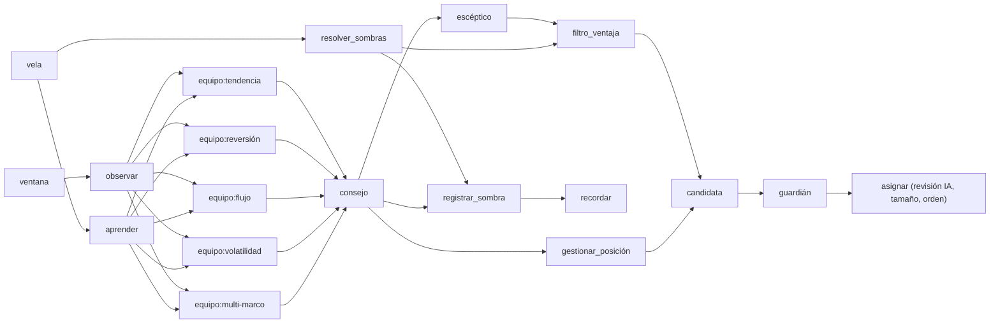

# Bot multiagente de señales cripto: grafo de nodos, aprendizaje y mejora automática

> ⚠️ **Material educativo, no asesoramiento financiero.** Ningún sistema puede
> garantizar beneficios ni evitar todas las pérdidas. El modo con dinero real
> está **bloqueado por código** hasta que el bot supere 20 días en papel, y
> aun así puede perder. Invierte solo lo que puedas permitirte perder.

## Objetivo acordado

**Máximo rendimiento con una caída máxima del 10 %.** Ese límite lo vigila
todo el sistema:

- el optimizador descalifica cualquier configuración que caiga más de un 10 %;
- un interruptor en vivo lo cierra todo si el capital cae un 10 % desde su máximo.

El bot también muestra siempre el **rendimiento semanal equivalente**, para
compararlo con la meta del +18 % semanal. Lo mide, pero no arriesga el capital
para perseguirlo.

## Arquitectura: nodos enlazados

`python bot.py graph` dibuja el grafo real en formato Mermaid. Cada vela, cada
símbolo lo recorre:



| Nodo | Qué hace |
|---|---|
| `observar` | 94 agentes por símbolo analizan la ventana. Con 8 monedas son ≈ 800 señales por vela, a más de 30.000 señales/segundo. |
| `equipo:*` | Cada equipo vota con pesos aprendidos (algoritmo *Hedge*), separados por régimen de mercado. |
| `consejo` | Confronta a los 5 equipos, también con pesos aprendidos. |
| `escéptico` | Veta si hay desacuerdo entre equipos, si el régimen es volátil o si habría que comprar bajo la EMA 200. |
| `filtro_ventaja` | Solo deja pasar tipos de señal con ventaja neta demostrada en la sombra. |
| `registrar_sombra` | Prueba cada señal sin dinero real, con stop, objetivo y comisiones. |
| `gestionar_posición` | Stop, objetivo 2:1, stop a break-even tras +1R y stop dinámico. |
| `guardián` | Interruptor por caída del 10 % y pausa tras 3 pérdidas seguidas. |
| `asignar` | Revisión opcional de la IA (freelm), tamaño por riesgo (1 %) y orden. |

Los nodos se añaden o se quitan con `Graph.add` / `Graph.remove`. El orden de
ejecución se calcula solo, a partir de lo que cada nodo necesita y produce.

## Mejora automática (`optimize`)

Un optimizador evolutivo cruza y muta configuraciones: umbrales, riesgo, stops,
qué equipos participan, velocidades de aprendizaje...

1. Los datos se dividen en **aprender 50 %, validación 25 % y examen final 25 %**.
2. Selecciona las configuraciones por su resultado en validación, con un
   mínimo de operaciones y la caída limitada al 10 %.
3. Una nueva campeona solo se acepta si **también gana en el examen final**,
   con datos que nunca vio. Esta es la defensa contra el sobreajuste.
4. Cada ronda queda en `optimize_history.jsonl`. La campeona se guarda en
   `champion.json` y la usan `backtest` y `live` automáticamente.

Las señales de los agentes se guardan en caché, así que cada simulación tarda
unos 2 segundos y una ronda completa, unos 2–4 minutos.

## Plan de 20 días

```bash
pip install -e . ccxt          # desde la raíz del repo; ccxt = conexión con exchanges

# Día 0: primera optimización con datos reales
python examples/trading_agents/bot.py optimize --source binance --limit 5000

# Días 1-20: el bot en papel, con tus 100 € simulados (déjalo corriendo)
python examples/trading_agents/bot.py live --llm

# Cada día, una ronda de mejora (cron: 0 3 * * *)
python examples/trading_agents/bot.py optimize --source binance --limit 5000

# Cuando quieras: ¿cómo va? ¿está listo?
python examples/trading_agents/bot.py status --source binance
python examples/trading_agents/bot.py gate
```

`gate` solo da el visto bueno si hay **20 días en vivo**, **rendimiento
positivo**, **caída ≤ 10 %** y **al menos 5 operaciones cerradas**.

## Paso a dinero real (solo si `gate` dice APTO)

1. **Exchange.** Binance por defecto. Con ccxt, Kraken o Bitvavo (reguladas en
   la UE) también funcionan: `--exchange-id kraken`.
2. **Claves API.** Créalas con permiso **solo de trading**, **nunca de
   retirada**, y restringidas a tu IP. Después, en el entorno:
   `export FREELM_EXCHANGE_KEY=... FREELM_EXCHANGE_SECRET=...`
3. **Ensayo opcional en el testnet** del exchange: `live --exchange testnet`.
4. **Dinero real:**
   `live --exchange real --confirm-real-money --max-capital 100`.
   - `--max-capital` es un **tope duro**: el bot nunca usa más, aunque la cuenta tenga más saldo.
   - Cada compra lleva un **stop-loss colocado en el propio exchange**, que protege aunque tu ordenador se apague.

**Con 100 €:** cada operación arriesga ≈ 1 € (1 %) y, como mucho, se invierten
30 € por moneda. El mínimo de orden en Binance es de unos 5 USDT, y el bot
omite las órdenes más pequeñas. Las comisiones son del 0,1 % por lado y ya
están incluidas en todas las simulaciones.

## Otros comandos

```bash
python examples/trading_agents/bot.py bench               # señales por segundo
python examples/trading_agents/bot.py backtest -v         # aprender y validar (sintético, sin red)
python examples/trading_agents/bot.py backtest --source binance --limit 5000
```

## Añadir un agente o un nodo

```python
# agente nuevo (agents.py -> agent_swarm)
class MiAgente(Agent):
    team = "flujo"
    def __init__(self):
        self.name, self.warmup = "mi_agente", 30
    def analyze(self, f):
        return Signal(self.name, 1 if f.price > f.closes[-10] else -1, 0.5, "momentum 10 velas")

# nodo nuevo en el grafo (p. ej. un veto propio)
def solo_horario_europeo(ctx):
    if not 7 <= time.gmtime(ctx["candle"].time / 1000).tm_hour <= 20:
        ctx["decision"].vetoes.append("fuera de horario")
    ctx["horario"] = True
engine.symbol_graph.add(Node("horario", ("skeptic",), ("horario",), solo_horario_europeo))
```

## Herramientas open source en las que se inspira o que usa

- [ccxt](https://github.com/ccxt/ccxt): conexión con más de 100 exchanges (lo usa directamente).
- [freqtrade](https://github.com/freqtrade/freqtrade): estrategias de ejemplo, hyperopt y protecciones.
- [jesse](https://github.com/jesse-ai/jesse), [backtrader](https://github.com/mementum/backtrader), [Lean](https://github.com/QuantConnect/Lean): indicadores y metodología de backtest.
- [freelm](../../README.md): el analista IA con LLM gratuitos y failover.

## Resultados de referencia (datos sintéticos, NO reales)

Una ronda de `optimize` (33 simulaciones) sobre datos sintéticos con inercia
obtuvo en el examen final **+35,7 % con una caída máxima del 3,6 %**, frente al
+27,7 % de la configuración de partida. **Esto solo demuestra que la mecánica
funciona.** Los datos sintéticos contienen patrones a propósito; el mercado
real es mucho más difícil. Las cifras que cuentan son las de
`--source binance` y, sobre todo, las de los 20 días en vivo.
