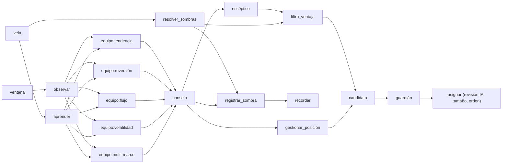

# Bot multiagente de señales cripto: grafo de nodos, aprendizaje y mejora automática

> ⚠️ **Material educativo, no asesoramiento financiero.** Ningún sistema puede
> garantizar beneficios ni evitar todas las pérdidas. El modo con dinero real
> está **bloqueado por código** hasta que el bot supere 20 días en papel, y
> aun así puede perder. Invierte solo lo que puedas permitirte perder.

## Objetivo acordado

**Máximo rendimiento con una caída máxima del 10 %.** Ese límite lo vigila
todo el sistema:

- el optimizador descalifica cualquier configuración que caiga más de un 10 %;
- un interruptor en vivo lo cierra todo si el capital cae un 10 % desde su máximo.

El bot también muestra siempre el **rendimiento semanal equivalente**, para
compararlo con la meta del +18 % semanal. Lo mide, pero no arriesga el capital
para perseguirlo.

## Regla de entrada: probabilidad de acierto ≥ 77 % **verificada**

El bot solo abre una posición si se cumple **todo** esto:

1. **Probabilidad medida en la sombra.** Cada tipo de señal se «opera» sin
   dinero con 4 perfiles de salida a la vez (objetivo a 0,75 / 1,125 / 1,5 / 3 ATR,
   stop a 1,5 ATR), pagando comisión y deslizamiento. Una operación «acierta»
   si cierra en positivo tras costes.
2. **Cota inferior de Wilson ≥ 77 %, con z = 3.** No basta con que el acierto
   medido sea del 77 %: tiene que serlo con un 99,9 % de confianza. El z alto
   corrige las pruebas múltiples: con decenas de combinaciones de tipo y perfil,
   alguna saldría buena por azar.
3. **Muestras efectivas.** Si las sombras se solapan en el tiempo, cuentan
   menos (n_eff = n × separación / duración media).
4. **Ganancia esperada positiva.** Acertar el 78 % con objetivos diminutos
   puede perder dinero; esas señales se rechazan.
5. **Punto en el tiempo.** Cada decisión usa solo sombras cerradas antes de ella.
   Las salidas reales son **idénticas** a las medidas (sin stop dinámico ni
   cierres «a ojo»), así que la probabilidad vale para esa operación.
6. **El optimizador nunca puede rebajar el 77 %.**

`backtest` muestra la **verificación**: probabilidad prometida frente a acierto
real. Si ninguna señal cumple, el bot no opera, y es lo correcto.

**Tiempo real:** `live` usa ahora velas de 5 minutos por defecto (`--interval
1m|5m`). Descarga las 8 monedas en paralelo y decide 1,5 s después del cierre
de cada vela. Necesita el servidor Oracle encendido; GitHub Actions sigue con
velas de 1 hora.

## Órdenes límite (`--entry-mode limit`) y comisión con BNB (`--bnb`)

En velas de 5 minutos, el coste de ida y vuelta de las órdenes a mercado
(~0,30 %: comisión 0,1 % + deslizamiento 0,05 % por lado) se come casi todo el
movimiento. Con `--entry-mode limit`:

- la compra se coloca como **orden límite** al cierre de la vela con señal (o
  `limit_offset_atr` por debajo). Se considera ejecutada **solo si el precio
  la atraviesa** en las `limit_wait` velas siguientes; si no, se cancela y la
  ocasión se pierde (queda contada en `missed`);
- el objetivo se cobra como venta límite (maker, sin deslizamiento). El stop y
  el cierre por horizonte, a mercado (taker + deslizamiento);
- la prueba en la sombra usa exactamente las mismas reglas y lleva su propia
  estadística (claves `L|...`), así que la probabilidad del 77 % se verifica
  para este modo por separado;
- `--bnb` aplica la comisión con descuento (0,075 % por lado).

En Binance spot, la cuenta estándar cobra **la misma comisión** a maker y a
taker. Lo que se ahorra con órdenes límite es el deslizamiento y el spread, así
que el coste baja ~1,5–2 veces, no más.

**En testnet o dinero real** la compra límite se coloca de verdad en el exchange.
En cada vela se consulta su estado (ejecutada, parcial o pendiente) y se cancela
al vencer. Como el stop ya está puesto como orden en el exchange, el objetivo se
vigila vela a vela y se vende **a mercado** (taker). Ese modo lleva su propia
estadística (claves `LT|`), así que el 77 % se verifica con esos costes.

## Seguridad operativa (fase 1)

- **Integridad de datos.** Antes de decidir, cada ventana de velas se valida:
  huecos, velas repetidas o fuera de orden, precios no válidos, máximo/mínimo
  incoherentes, saltos de más del 35 % en una vela. Si algo falla, **ese símbolo no
  se aprende ni se decide en esa vela** (`report.data_issues`).
- **Datos atrasados (en vivo).** Si la última vela cerrada tiene más de 2
  intervalos, no se opera y se avisa una vez por Telegram.
- **Límite de pérdida diaria** (`max_daily_loss`, 3 %). Si la pérdida realizada
  más la no realizada del día UTC supera el límite, no hay entradas nuevas hasta el día
  siguiente. Es independiente del interruptor del 10 %.
- **Diario de decisiones** (`<datos>/diario/decisiones-AAAAMMDD.jsonl`): una línea
  por símbolo y vela, con el veredicto de cada equipo, los vetos y su motivo, la
  probabilidad verificada, las aperturas y cierres, la cartera, los avisos y los
  errores. Nunca guarda claves.
- **Órdenes idempotentes.** Cada orden lleva un `clientOrderId` determinista
  (tipo + moneda + vela). Si la red corta la respuesta, antes de reintentar se
  busca la orden en el exchange: **nunca se envía dos veces**.
- **Conciliación al arrancar** (testnet/real). Si una posición guardada ya no
  está en la cuenta (por ejemplo, el stop se ejecutó con el bot apagado), se cierra
  en el libro. Las que siguen reciben de nuevo su stop en el exchange y se borran
  los stops viejos del bot.
- **Alertas de conexión.** Tras 3 errores seguidos se avisa por Telegram, y
  también cuando la conexión se recupera.

## Arquitectura: nodos enlazados

`python bot.py graph` dibuja el grafo real en formato Mermaid. Cada vela, cada
símbolo lo recorre:



| Nodo | Qué hace |
|---|---|
| `observar` | 105 agentes por símbolo analizan la ventana. Con 8 monedas son ≈ 900 señales por vela, a más de 30.000 señales/segundo. |
| `equipo:*` | Cada equipo vota con pesos aprendidos (algoritmo *Hedge*), separados por régimen de mercado. |
| `consejo` | Confronta a los 7 equipos (tendencia, reversión, flujo, volatilidad, multi-marco, mercado y posicionamiento), también con pesos aprendidos. |
| `escéptico` | Veta si hay desacuerdo entre equipos, si el régimen es volátil, si habría que comprar bajo la EMA 200 o si todo el mercado está en fase bajista (BTC bajo su media 200 y menos del 35 % de monedas al alza). |
| `filtro_ventaja` | Solo deja pasar tipos de señal con ventaja neta demostrada en la sombra. |
| `registrar_sombra` | Prueba cada señal sin dinero real, con stop, objetivo y comisiones. |
| `gestionar_posición` | Stop, objetivo 2:1, stop a break-even tras +1R y stop dinámico. |
| `guardián` | Interruptor por caída del 10 % y pausa tras 3 pérdidas seguidas. |
| `asignar` | Revisión opcional de la IA (freelm), tamaño por riesgo (1 %) y orden. El riesgo total abierto (suma de distancias al stop) nunca pasa del 3 % del capital. |

**Equipo «mercado»**: el único que mira todas las monedas a la vez.

- **Fuerza relativa** a 1, 3 y 7 días: el momentum entre criptos es de los efectos más estudiados.
- **Amplitud**: qué parte del mercado está al alza.
- **BTC como guía**: su tendencia de fondo y su último día.
- **Sentimiento**: el índice Fear & Greed (alternative.me, gratis), leído a la contra. El miedo extremo suma a favor de comprar y la codicia extrema, en contra. Solo se usa con datos reales; `--no-sentiment` lo desactiva.

**Equipo «posicionamiento»**: quién empuja el precio y quién está apalancado.

- **Flujo comprador agresivo (taker)** a 6, 24 y 72 velas: qué parte del volumen
  se compró «a mercado». Viene gratis en cada vela de Binance (antes se descartaba).
- **Funding rate de los futuros perpetuos**, leído a la contra: un funding muy
  alto significa largos apalancados y sobrecompra; uno muy negativo, cortos
  apalancados. Se descarga del archivo público `data.binance.vision`, sin
  claves ni bloqueo geográfico; el tramo más reciente sale de la API de futuros
  o, si está bloqueada, de OKX o Bybit vía ccxt. `--no-funding` lo desactiva.

**Capacidad predictiva de cada agente** (IC, al estilo alphalens): `backtest`
y `status` muestran qué agentes predicen de verdad el retorno siguiente
(|t| > 2) y cuáles son ruido. `status --all-agents` da la tabla completa.

**Horizonte de aprendizaje** (`learn_horizon`, por defecto 1): cada agente se
premia o castiga con el retorno de las *h* velas siguientes a su señal, no solo
con la de la vela siguiente. Así se le juzga en el mismo plazo que dura una
operación. Con *h* > 1 los retornos se solapan, y la t del IC se divide por
√h para no inflarla. El optimizador busca *h* entre 1 y 36 velas.

**Informe profesional** (al estilo quantstats, sin dependencias): Sortino,
Calmar, duración de la peor caída, días positivos, mejor y peor día,
rendimiento por meses, esperanza por operación y rachas. Aparece en
`backtest`, en `report`, en GitHub y en Telegram.

Los nodos se añaden o se quitan con `Graph.add` / `Graph.remove`. El orden de
ejecución se calcula solo, a partir de lo que cada nodo necesita y produce.

## Validación estadística de estrategias (`validate`)

Ganar en un backtest no basta. `python bot.py validate --source binance --interval 4h`
prueba una **familia** de estrategias: la regla de entrada (`77` = la tuya,
`ev50` = esperanza > 0 y acierto verificado ≥ 50 %) combinada con cada horizonte
de aprendizaje (1, 6, 12, 24 y 36 velas). Solo declara **VALIDADA** una
estrategia que pasa **todas** estas pruebas:

| Prueba | Exigencia |
|---|---|
| Walk-forward: aprende con el 40 % inicial y opera el 60 % restante sin dejar de aprender, siempre solo con el pasado | ≥ 30 operaciones, gana dinero, caída ≤ 10 % |
| Constancia: el tramo operado se parte en 4 | ≥ 3 de 4 tramos en positivo |
| Deflated Sharpe (Bailey y López de Prado), que descuenta **todas** las pruebas hechas (`--prior-trials`) | ≥ 0,95 |
| PBO por CSCV: probabilidad de que la mejor de la familia sea sobreajuste | ≤ 25 % |
| Sensibilidad: los horizontes vecinos | también ganan |
| Bootstrap del resultado medio por operación | intervalo del 95 % > 0 R |

Guarda el detalle en `validation.json`. Sale con código 3 si no se valida
ninguna estrategia. El workflow de investigación la ejecuta en cada PR, a 4 h y a 1 h.

**Resultado con datos reales** (noviembre de 2026; 8 monedas, 5000 velas, 30
pruebas descontadas):

| | 4 h (~68 semanas operadas) | 1 h (~17 semanas operadas) |
|---|---|---|
| Regla 77 %, todos los horizontes | 0 operaciones | 0 operaciones |
| Mejor `ev50` | h24: +9,9 %, 37 ops, acierto 78 %, IC95 % [+0,06, +0,53] R | h36: +1,2 % con solo 2 ops |
| …pero | todo el beneficio en el último tramo (0 %, 0 %, 0 %, +9,9 %); DSR 0,42 | el resto de `ev50`, entre −0,8 % y −5 % |
| PBO de la familia | **53 %** | **39 %** |
| Cesta comprar y mantener | −55,5 % | −2,8 % |
| **Veredicto** | **ninguna validada** | **ninguna validada** |

En pocas palabras: el bot protege el capital, pero **no se ha demostrado una
ventaja real**. Elegir «la mejor» de estas variantes no generaliza: el PBO es
cercano al 50 %, lo mismo que elegir al azar. Por eso no se recomienda pasar a
dinero real con ninguna de ellas.

### Estrategias clásicas (`classic`)

`python bot.py classic --source binance` aplica las **mismas pruebas** a las
dos familias con más evidencia publicada, en velas diarias (`strategies.py`):

- **Momentum de tendencia** (`tsmom`): se compra cuando el cierre está por
  encima de su media de 20, 50, 100, 150 o 200 días.
- **Momentum relativo** (`xsmom`): cada semana se compran las monedas que más
  subieron en 7, 14, 28, 56 o 90 días, solo si subieron.
- **El conjunto**: las 10 variantes a partes iguales, sin elegir ninguna.

Todas son solo spot, con un máximo de 4 posiciones de ≤ 25 % cada una. Pagan
comisión y deslizamiento.

**Mejoras tras analizar GitHub** (ideas, no código copiado):

| Mejora | Inspirada en | Opción |
|---|---|---|
| Volatilidad de la cartera con la **covarianza real** y *shrinkage* hacia correlación constante (Ledoit-Wolf), en vez de suponer correlación 1 | Riskfolio-Lib, skfolio, PyPortfolioOpt | `--risk-model cov` (por defecto) |
| **Historia completa**: cada moneda entra cuando empieza a cotizar (2019–2026, con dos mercados bajistas), así hay más datos y más potencia estadística | Qlib, Lean | por defecto; `--aligned` para la versión anterior |
| **Control de caída** proporcional al colchón (CPPI), con máximo histórico o móvil | Grossman y Zhou (1993); protections de freqtrade | `--dd-budget 0.10 --dd-window 365` |
| **Motor rápido**: un `Panel` precalcula sumas acumuladas y la media, la volatilidad y la covarianza cuestan O(1); un panel sirve para toda la familia | vectorbt | siempre; un test garantiza el mismo resultado exacto que el motor anterior |
| **Sensibilidad al universo**: el conjunto se repite quitando cada moneda | contra el sesgo de supervivencia | siempre |

Velocidad medida con los mismos datos: la simulación es 2,5 veces más rápida y
la validación completa unas 3,5 veces (el bootstrap, que era el 94 % del tiempo,
ahora es ~20 veces más rápido). No es 15 veces: es lo que se ha medido.

**Resultados con datos reales** (8 monedas, 2019-03 → 2026-11, ~7,7 años
operados; se descuentan **106 pruebas**, todas las hechas en esta investigación):

| Variante | Conjunto: al año | Caída máx. | DSR | PBO | Validadas |
|---|---|---|---|---|---|
| A. Original (correlación 1, vol. 12 %) | +13,6 % | 15,4 % | 0,98 | 16 % | 0 (caída) |
| B. + control de caída (máximo histórico) | +5,7 % | 8,5 % | 0,67 | 12 % | 0: al tocar el 10 % se queda en liquidez para siempre |
| C. Covarianza real | +16,6 % | 16,3 % | 0,98 | 13 % | 0 (caída) |
| D. Covarianza + control de caída con máximo de 1 año | +12,8 % | 12,5 % | 0,99 | 27 % | 0 |
| **E. Covarianza + vol. objetivo 5 %** (regla fijada antes de mirar: caída máx. / 2) | **+7,9 %** | **7,0 %** | **1,00** | 18 % (17–43 % según el día de inicio) | conjunto + 7 de 10 en un inicio; **0 en los 7 inicios** |

- E supera todas las pruebas con los datos tal como empiezan, **pero no es
  robusto al calendario**. Si la prueba empieza 1 a 6 días más tarde, el
  reequilibrio semanal cambia de día:
  - el **conjunto** apenas varía: +6,8 % a +7,9 % al año, caída del 6,7 % al
    8,2 % y DSR de 0,98 a 1,00 en 15 inicios distintos;
  - el **PBO** de la familia oscila entre el 17 % y el 43 %, y solo cumple el
    ≤ 25 % en 6 de 15 inicios.

  Por eso `classic` exige ahora pasar en los 7 inicios de una semana
  (`--phases 7`) y el veredicto es **NO validada de forma robusta**: el
  conjunto es estable, pero elegir variantes dentro de la familia no generaliza.
- Sin ninguna de las monedas (también sin SOL o sin AVAX), el conjunto da de
  +7,1 % a +8,0 % al año con caídas ≤ 7,7 %. Solo con BTC y ETH, +5,1 % al año y
  una caída del 5,8 %.
- La cesta comprar y mantener hizo +1451 % en el mismo periodo: este momentum
  **renuncia a gran parte de las subidas** a cambio de caídas pequeñas.
- **Pegas que siguen ahí:**
  - El último tramo (2025–2026) fue ligeramente negativo (−1,8 %).
  - El universo son las monedas grandes de hoy: el **sesgo de supervivencia**
    no está descartado (faltan LUNA, FTT…).
  - Acierta un 37 % de las operaciones: es **incompatible con la regla del 77 %**.
  - Con 100 € muchas posiciones serían menores que el mínimo de orden de Binance.

### Momentum combinado en papel: prueba de 20 días (`momentum`)

Corre en **papel**, con 100 € simulados, durante 20 días. Usa la configuración
E de `classic` (covarianza, volatilidad 5 %): la candidata más sólida, estable en
todos los inicios, aunque **no validada de forma robusta** y aún sin probar con
datos que nadie ha visto. Si cambia la
configuración, la prueba se reinicia sola y lo avisa, para no mezclar resultados:

- `python bot.py momentum` procesa un día por ejecución, tras el cierre diario
  de las 00:00 UTC. No repite días y no hace nada con datos dudosos o atrasados.
  Si la caída supera el 10 %, pasa todo a liquidez y se detiene.
- `python bot.py momentum --report` muestra cómo va: días, capital, caída,
  cesta y posiciones.
- En GitHub Actions lo ejecuta `momentum-paper.yml` cada día a las 00:17 UTC.
  La memoria se guarda en la rama `momentum-state` y avisa por Telegram si está
  configurado.
- El diario de decisiones (`diario/`) registra cada orden en papel y la cartera.
- A los 20 días da el resultado y deja de operar. **20 días son pocos para
  demostrar una ventaja.** Pasar a dinero real sigue necesitando una validación
  estadística aprobada y tu autorización expresa.
- Con 100 €, muchas posiciones de la media serían menores que el mínimo de
  orden de Binance (≈ 5–6 €). En papel no importa; en real habría que agruparlas.

### Tarjeta de aciertos de las señales (`senales`)

Para entender **qué funciona y cuánto acierta**, cada señal se mide por
separado, **se opere o no**. Si la cartera está en liquidez semanas enteras, la
prueba en papel no dice nada; esta tarjeta sí.

- Para cada día y cada moneda, cada una de las 10 variantes dice «largo» (la
  compraría) o «fuera». A 1, 7 y 30 días se mira qué hizo la moneda.
- **Acierto**: % de señales «largo» tras las que la moneda subió, con su
  intervalo de Wilson del 95 %. Las muestras efectivas son n/h, porque los
  retornos a h días se solapan.
- **Tasa base**: % de veces que una moneda sube sin señal. Acertar el 52 % no
  vale nada si las monedas suben el 52 % de los días de todas formas.
- **Ventaja**: retorno medio tras «largo» menos retorno medio tras «fuera», con
  su intervalo del 95 %.

`python bot.py senales` calcula la tarjeta con la historia completa (las reglas
son fijas, no hay nada ajustado). `--record` guarda las señales del día en
`senales.jsonl`, y días después se puntúan con precios que nadie había visto:
esa es la prueba fuera de muestra de verdad. `momentum-paper.yml` lo hace cada
día y lo muestra en el resumen.

**Resultado con la historia (2019–2026, 8 monedas):**

| | Acierto a 7 días | Tasa base | Ventaja a 7 días (IC 95 %) |
|---|---|---|---|
| Mejores variantes (tsmom·50, xsmom·14, xsmom·28) | 51–52 % | 50 % | +2,3 % a +2,8 % (≈ +1,1 % a +4,0 %) ✔ |
| Conjunto | 49 % | 50 % | +1,2 % (+0,2 %, +2,2 %) ✔ |
| A 30 días | 49–54 % | 50 % | +1 % a +5,5 %, pero el intervalo incluye 0 |

**Conclusión:** las señales **no aciertan la dirección más que el azar**
(~50 %), y ninguna supera la tasa base con confianza. Su ventaja real y
significativa está en **cuánto** suben: tras «largo» las monedas rinden de
media más que tras «fuera», sobre todo porque «fuera» evita los peores tramos
bajistas. Por eso esta familia nunca puede cumplir una regla de «acierto ≥ 77 %».
Para los 105 agentes técnicos de `live`, la medida equivalente es su IC en vivo:
`python bot.py status --all-agents`.

### Panel, Supabase y avisos (`panel`, `sync`, `notificar`)

- `python bot.py panel --open` genera **un solo archivo HTML**, sin internet ni
  librerías, con:
  - el capital en papel frente a la cesta y las posiciones;
  - la tarjeta de aciertos **en vivo**;
  - las señales de los últimos días y los avisos del diario.

  GitHub Actions lo regenera cada día: queda en la rama `momentum-state` y como
  archivo descargable de la ejecución.
- `python bot.py sync` sube a **Supabase** los días en papel, las señales y la
  tarjeta de aciertos.
  - Solo actúa si existen `SUPABASE_URL` y `SUPABASE_KEY` (la clave secreta, que
    se lee del entorno y nunca se escribe ni se muestra).
  - El esquema, con lectura pública de solo lectura por RLS, está en
    `deploy/supabase.sql`.
  - Cada subida es un *upsert*: repetirla no duplica filas.
- `FREELM_WEBHOOK_URL` envía los avisos a un webhook (p. ej. Zapier → Gmail),
  además o en lugar de Telegram. `python bot.py notificar` envía un aviso de prueba.
- El asistente de Windows guía todo esto: opciones 14–19 y la tarea diaria a las 01:30.

## Mejora automática (`optimize`)

Un optimizador evolutivo cruza y muta configuraciones: umbrales, riesgo, stops,
qué equipos participan, velocidades de aprendizaje...

1. Los datos se dividen en **aprender 40 %, validación 40 % (en 3 tramos) y
   examen final 20 %**.
2. La nota premia la **constancia**: la mitad es el tramo mediano y la otra
   mitad el **peor** tramo. Además se exige un mínimo de operaciones y la caída
   máxima queda limitada al 10 %.
3. **Prueba de estrés de Monte Carlo.** Las operaciones de cada configuración
   se barajan en cientos de órdenes distintos. Si en una mala racha (el peor 5 %)
   la caída superaría el 10 %, la configuración se penaliza.
4. Una nueva campeona solo se acepta si **también gana en el examen final**,
   con datos que nunca vio. Esta es la defensa contra el sobreajuste.
5. Cada ronda queda en `optimize_history.jsonl`. La campeona se guarda en
   `champion.json` y la usan `backtest` y `live` automáticamente.

**Velocidad.** Las señales de los agentes se calculan una sola vez (caché) y las
simulaciones corren en paralelo en todos los núcleos (`--workers`). En 4
núcleos son unas 115 configuraciones por minuto, frente a 25 antes; una ronda
completa tarda unos 2 minutos.

## Plan de 20 días

```bash
pip install -e . ccxt          # desde la raíz del repo; ccxt = conexión con exchanges

# Día 0: primera optimización con datos reales
python examples/trading_agents/bot.py optimize --source binance --limit 5000

# Días 1-20: el bot en papel, con tus 100 € simulados (déjalo corriendo)
python examples/trading_agents/bot.py live --llm

# Cada día, una ronda de mejora (cron: 0 3 * * *)
python examples/trading_agents/bot.py optimize --source binance --limit 5000

# Cuando quieras: ¿cómo va? ¿está listo?
python examples/trading_agents/bot.py status --source binance
python examples/trading_agents/bot.py gate
```

`report` imprime el mismo resumen que llega por Telegram y aparece en GitHub.

**Datos robustos.** Si Binance falla, el bot reintenta 3 veces (esperando 2 y
4 s) y después usa OKX, Bybit o Kraken vía ccxt. Un corte de red no lo deja
ciego.

`gate` solo da el visto bueno si hay **20 días en vivo**, **rendimiento
positivo**, **caída ≤ 10 %** y **al menos 5 operaciones cerradas**.

## Windows: asistente de instalación

Descarga el ZIP del repositorio, descomprímelo y haz doble clic en
`examples/trading_agents/windows/Instalar-Bot.bat`. El asistente instala
Python si falta, el bot, las claves (opcionales) y el arranque automático en
papel, y crea accesos directos para el panel y el informe. Guía completa:
[`windows/LEEME.md`](windows/LEEME.md).

## Servidor gratuito

### Fase 1, los 20 días en papel: GitHub Actions (0 €, sin servidor)

El workflow `.github/workflows/trading-bot.yml` hace dos cosas:

- **cada hora** procesa la última vela;
- **cada día a las 03:00 UTC** hace además una ronda de mejora.

Como cada ejecución empieza de cero, la memoria se guarda en la rama
`trading-state` (`deploy/gh_state.sh`).

1. Fusiona esta rama en `main`. GitHub solo ejecuta las tareas programadas
   desde la rama por defecto.
2. Si tu repo es un fork, entra una vez en la pestaña *Actions* y pulsa «Enable workflows».
3. Opcional, en *Settings → Secrets and variables → Actions*:
   - `GEMINI_API_KEY` y/o `GROQ_API_KEY` (gratis), para el analista IA;
   - `TELEGRAM_BOT_TOKEN` y `TELEGRAM_CHAT_ID`, para recibir en el móvil cada
     compra, cada venta, el interruptor de emergencia y un resumen diario
     (cómo obtenerlos: `notify.py`).
4. Ya está. En *Actions → trading-bot → cualquier ejecución* verás el informe
   (capital, rendimiento, semanal equivalente, caída, operaciones y estado de
   la puerta). Con *Run workflow* puedes lanzarlo a mano, con o sin optimización.

Coste: unos 1.000–1.500 minutos al mes. En repositorios públicos es ilimitado;
en privados entra en los 2.000 minutos gratuitos. GitHub puede retrasar unos
minutos las tareas programadas, y no pasa nada. Este workflow **nunca** opera
con dinero real.

### Fase 2, dinero real: Oracle Cloud Always Free (0 €, 24/7)

Para dinero real hace falta un servidor fijo:

- los servidores de GitHub están en EE. UU., donde Binance no permite operar;
- las claves de trading no deben estar en un servicio compartido.

Oracle regala para siempre una máquina ARM (hasta 4 núcleos y 24 GB) en
regiones europeas como Madrid o Frankfurt.

1. Crea la cuenta en oracle.com/cloud/free. Piden tarjeta solo para verificar;
   las máquinas «Always Free» no cobran.
2. Crea una instancia **Ubuntu, forma VM.Standard.A1.Flex (Always Free)** en tu región.
3. Por SSH:
   `git clone -b claude/intelligent-multi-agent-bot-79boq0 https://github.com/TU_USUARIO/freelm.git && bash freelm/examples/trading_agents/deploy/oracle-setup.sh`
4. Pon tus claves en `deploy/bot.env` (plantilla: `bot.env.example`).
   Restringe la clave del exchange a la IP del servidor.
5. Cuando `gate` diga APTO, cambia la línea `command:` de `docker-compose.yml`
   a la versión «real» y ejecuta `sudo docker compose up -d`.

## Paso a dinero real (solo si `gate` dice APTO)

1. **Exchange.** Binance por defecto. Con ccxt, Kraken o Bitvavo (reguladas en
   la UE) también funcionan: `--exchange-id kraken`.
2. **Claves API.** Créalas con permiso **solo de trading**, **nunca de
   retirada**, y restringidas a tu IP. Después, en el entorno:
   `export FREELM_EXCHANGE_KEY=... FREELM_EXCHANGE_SECRET=...`
3. **Ensayo opcional en el testnet** del exchange: `live --exchange testnet`.
4. **Dinero real:**
   `live --exchange real --confirm-real-money --max-capital 100`.
   - `--max-capital` es un **tope duro**: el bot nunca usa más, aunque la cuenta tenga más saldo.
   - Cada compra lleva un **stop-loss colocado en el propio exchange**, que protege aunque tu ordenador se apague.

**Con 100 €:** cada operación arriesga ≈ 1 € (1 %) y, como mucho, se invierten
30 € por moneda. El mínimo de orden en Binance es de unos 5 USDT, y el bot
omite las órdenes más pequeñas. Las comisiones son del 0,1 % por lado y ya
están incluidas en todas las simulaciones.

## Otros comandos

```bash
python examples/trading_agents/bot.py bench               # señales por segundo
python examples/trading_agents/bot.py backtest -v         # aprender y validar (sintético, sin red)
python examples/trading_agents/bot.py backtest --source binance --limit 5000
```

## Añadir un agente o un nodo

```python
# agente nuevo (agents.py -> agent_swarm)
class MiAgente(Agent):
    team = "flujo"
    def __init__(self):
        self.name, self.warmup = "mi_agente", 30
    def analyze(self, f):
        return Signal(self.name, 1 if f.price > f.closes[-10] else -1, 0.5, "momentum 10 velas")

# nodo nuevo en el grafo (p. ej. un veto propio)
def solo_horario_europeo(ctx):
    if not 7 <= time.gmtime(ctx["candle"].time / 1000).tm_hour <= 20:
        ctx["decision"].vetoes.append("fuera de horario")
    ctx["horario"] = True
engine.symbol_graph.add(Node("horario", ("skeptic",), ("horario",), solo_horario_europeo))
```

## Herramientas open source en las que se inspira o que usa

- [ccxt](https://github.com/ccxt/ccxt): conexión con más de 100 exchanges (lo usa directamente).
- [freqtrade](https://github.com/freqtrade/freqtrade): estrategias de ejemplo, hyperopt y protecciones.
- [jesse](https://github.com/jesse-ai/jesse), [backtrader](https://github.com/mementum/backtrader), [Lean](https://github.com/QuantConnect/Lean): indicadores y metodología de backtest.
- [freelm](../../README.md): el analista IA con LLM gratuitos y failover.

## Resultados con datos REALES (Binance, noviembre de 2026)

Workflow `trading-research.yml`: más de 200 días de velas de 1 h, 8 monedas,
100 €, con comisiones (0,1 %) y deslizamiento (0,05 %) por lado. Solo cuenta
el tramo fuera de muestra:

| Prueba | Bot | Comprar y mantener la cesta |
|---|---|---|
| 1 h, configuración por defecto | 0,00 % (0 operaciones) | −21,1 % |
| 4 h, configuración por defecto | 0,00 % (0 operaciones) | −19,8 % |
| 1 h, configuración optimizada | +0,75 % (26 operaciones, caída 3,6 %) | −21,4 % |

- El bot **protegió el capital** en un mercado que cayó un 20 %, pero **no
  encontró una ventaja real para ganar** en ese periodo. Una vez pagados los
  costes, casi todos los tipos de señal tuvieron esperanza negativa.
- El único tipo con ventaja neta (+0,24 R conservadora en 76 casos) fue
  «volátil + fuerza alta + acuerdo alto», que el veto de régimen volátil
  bloqueaba. Ahora ese veto está desactivado por defecto y decide el calibrador.
- En datos reales dominó la vuelta a la media. Por eso el optimizador puede
  probar ahora objetivos desde 1:1, no solo desde 1,5:1.
- Se corrigió un fallo del optimizador: aceptó una «campeona» que perdió un
  0,75 % con una sola operación. Ahora una campeona debe **ganar dinero**,
  ganar más que la anterior y hacerlo con al menos 3 operaciones en el examen final.

**Segunda ronda, con esos ajustes** (mismos datos y costes):

| Prueba | Bot | Comprar y mantener la cesta |
|---|---|---|
| 1 h, configuración por defecto | **+2,42 %** (16 operaciones, acierto 62 %, factor de beneficio 1,47, caída 2,4 %) | −21,5 % |
| 4 h, configuración por defecto | 0,00 % (0 operaciones) | −20,0 % |

- El optimizador **rechazó** esta vez una aspirante que perdía (−0,84 % con 1
  operación): la corrección funciona.
- **16 operaciones son pocas.** La prueba de estrés da un 31 % de
  probabilidad de acabar en pérdidas con esas mismas operaciones. Es una
  señal prometedora en un mercado bajista, no una ventaja demostrada. Para
  eso están los 20 días en vivo.

**Tercera ronda, con la regla del 77 % verificado** (noviembre de 2026; 8
monedas, 5000 velas, comisión 0,1 % y deslizamiento 0,05 % por lado):

| Prueba | Bot | Comprar y mantener la cesta |
|---|---|---|
| 1 h, por defecto (regla 77 %) | 0,00 % (0 operaciones) | −28,3 % |
| 4 h, por defecto (regla 77 %) | 0,00 % (0 operaciones) | +2,6 % |
| 1 h y 4 h, `learn_horizon` 6, 12 o 24 (regla 77 %) | 0,00 % (0 operaciones) | — |

- El +2,42 % de la segunda ronda es **anterior** a la regla del 77 %. Con esa
  regla, ningún tipo de señal ha llegado al 77 % *verificable*. Es la cota
  inferior de Wilson con z = 3, necesaria porque se prueban ~100 combinaciones
  de tipo × perfil. El mejor llegó al 62–66 %, así que el bot no opera. No es un
  fallo, y la comprobación de datos de la fase 1 no descartó ni una vela.
- `learn_horizon` triplica el IC de los mejores agentes en 1 h (de 0,019 a
  0,06). Con la t corregida por solape, los agentes significativos pasan de 9 a 24.
- **Experimento, NO activado** (filtro rebajado al 50 % verificable, solo para
  medir): en 4 h con `learn_horizon` 24, +9,9 % con 37 operaciones, acierto
  real del 78 %, factor de beneficio 2,4 y caída del 3,8 %. En ese tramo la cesta
  hizo de −55 % a +2,6 %, según la ventana. Pero con *h* = 18 dio −4,2 % (5
  operaciones) y con *h* = 36, +1,9 %. Esa sensibilidad indica **fragilidad**,
  no una ventaja demostrada. La regla del 77 % sigue intacta.

## Resultados de referencia (datos sintéticos, NO reales)

Mismo backtest, mismos datos sintéticos, antes y después de añadir el equipo
«mercado», el veto de mercado bajista y el límite de riesgo total:

| Escenario | Antes | Ahora |
|---|---|---|
| Datos con patrones (`--structure 1`) | +29,1 %, caída 4,7 %, factor de beneficio 1,81 | +36,4 %, caída 5,1 %, factor 1,88 |
| Datos casi al azar (`--structure 0`) | +16,1 %, caída 7,3 %, factor 1,40 | +20,5 %, caída 4,3 %, factor 1,62 |

`backtest` muestra ahora también la prueba de estrés: con 1 % de riesgo por
operación, la caída en una mala racha (peor 5 %) rondaba el 11–12 %. Por eso el
optimizador penaliza las configuraciones cuya mala racha supera el 10 %.

Una ronda de `optimize` (33 simulaciones) sobre datos sintéticos con inercia
obtuvo en el examen final **+35,7 % con una caída máxima del 3,6 %**, frente al
+27,7 % de la configuración de partida. **Esto solo demuestra que la mecánica
funciona.** Los datos sintéticos contienen patrones a propósito; el mercado
real es mucho más difícil. Las cifras que cuentan son las de
`--source binance` y, sobre todo, las de los 20 días en vivo.
