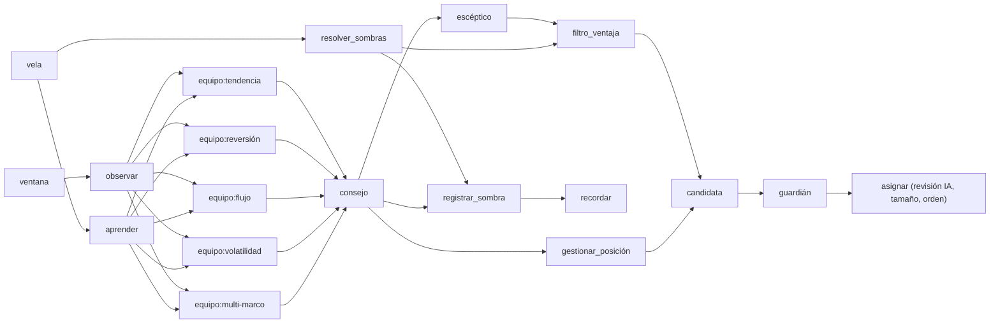

# Bot multiagente de señales cripto: grafo de nodos, aprendizaje y mejora automática

> ⚠️ **Material educativo, no asesoramiento financiero.** Ningún sistema puede
> garantizar beneficios ni evitar todas las pérdidas. El modo con dinero real
> está **bloqueado por código** hasta que el bot supere 20 días en papel, y
> aun así puede perder. Invierte solo lo que puedas permitirte perder.

## Objetivo acordado

**Máximo rendimiento con una caída máxima del 10 %.** Ese límite lo vigila
todo el sistema:

- el optimizador descalifica cualquier configuración que caiga más de un 10 %;
- un interruptor en vivo lo cierra todo si el capital cae un 10 % desde su máximo.

El bot también muestra siempre el **rendimiento semanal equivalente**, para
compararlo con la meta del +18 % semanal. Lo mide, pero no arriesga el capital
para perseguirlo.

## Arquitectura: nodos enlazados

`python bot.py graph` dibuja el grafo real en formato Mermaid. Cada vela, cada
símbolo lo recorre:



| Nodo | Qué hace |
|---|---|
| `observar` | 105 agentes por símbolo analizan la ventana. Con 8 monedas son ≈ 900 señales por vela, a más de 30.000 señales/segundo. |
| `equipo:*` | Cada equipo vota con pesos aprendidos (algoritmo *Hedge*), separados por régimen de mercado. |
| `consejo` | Confronta a los 7 equipos (tendencia, reversión, flujo, volatilidad, multi-marco, mercado y posicionamiento), también con pesos aprendidos. |
| `escéptico` | Veta si hay desacuerdo entre equipos, si el régimen es volátil, si habría que comprar bajo la EMA 200 o si todo el mercado está en fase bajista (BTC bajo su media 200 y menos del 35 % de monedas al alza). |
| `filtro_ventaja` | Solo deja pasar tipos de señal con ventaja neta demostrada en la sombra. |
| `registrar_sombra` | Prueba cada señal sin dinero real, con stop, objetivo y comisiones. |
| `gestionar_posición` | Stop, objetivo 2:1, stop a break-even tras +1R y stop dinámico. |
| `guardián` | Interruptor por caída del 10 % y pausa tras 3 pérdidas seguidas. |
| `asignar` | Revisión opcional de la IA (freelm), tamaño por riesgo (1 %) y orden. El riesgo total abierto (suma de distancias al stop) nunca pasa del 3 % del capital. |

**Equipo «mercado»**: el único que mira todas las monedas a la vez.

- **Fuerza relativa** a 1, 3 y 7 días: el momentum entre criptos es de los efectos más estudiados.
- **Amplitud**: qué parte del mercado está al alza.
- **BTC como guía**: su tendencia de fondo y su último día.
- **Sentimiento**: el índice Fear & Greed (alternative.me, gratis), leído a la contra. El miedo extremo suma a favor de comprar y la codicia extrema, en contra. Solo se usa con datos reales; `--no-sentiment` lo desactiva.

**Equipo «posicionamiento»**: quién empuja el precio y quién está apalancado.

- **Flujo comprador agresivo (taker)** a 6, 24 y 72 velas: qué parte del volumen
  se compró «a mercado». Viene gratis en cada vela de Binance (antes se descartaba).
- **Funding rate de los futuros perpetuos**, leído a la contra: un funding muy
  alto significa largos apalancados y sobrecompra; uno muy negativo, cortos
  apalancados. Se descarga del archivo público `data.binance.vision`, sin
  claves ni bloqueo geográfico; el tramo más reciente sale de la API de futuros
  o, si está bloqueada, de OKX o Bybit vía ccxt. `--no-funding` lo desactiva.

**Capacidad predictiva de cada agente** (IC, al estilo alphalens): `backtest`
y `status` muestran qué agentes predicen de verdad el retorno siguiente
(|t| > 2) y cuáles son ruido. `status --all-agents` da la tabla completa.

**Informe profesional** (al estilo quantstats, sin dependencias): Sortino,
Calmar, duración de la peor caída, días positivos, mejor y peor día,
rendimiento por meses, esperanza por operación y rachas. Aparece en
`backtest`, en `report`, en GitHub y en Telegram.

Los nodos se añaden o se quitan con `Graph.add` / `Graph.remove`. El orden de
ejecución se calcula solo, a partir de lo que cada nodo necesita y produce.

## Mejora automática (`optimize`)

Un optimizador evolutivo cruza y muta configuraciones: umbrales, riesgo, stops,
qué equipos participan, velocidades de aprendizaje...

1. Los datos se dividen en **aprender 40 %, validación 40 % (en 3 tramos) y
   examen final 20 %**.
2. La nota premia la **constancia**: la mitad es el tramo mediano y la otra
   mitad el **peor** tramo. Además se exige un mínimo de operaciones y la caída
   máxima queda limitada al 10 %.
3. **Prueba de estrés de Monte Carlo.** Las operaciones de cada configuración
   se barajan en cientos de órdenes distintos. Si en una mala racha (el peor 5 %)
   la caída superaría el 10 %, la configuración se penaliza.
4. Una nueva campeona solo se acepta si **también gana en el examen final**,
   con datos que nunca vio. Esta es la defensa contra el sobreajuste.
5. Cada ronda queda en `optimize_history.jsonl`. La campeona se guarda en
   `champion.json` y la usan `backtest` y `live` automáticamente.

**Velocidad.** Las señales de los agentes se calculan una sola vez (caché) y las
simulaciones corren en paralelo en todos los núcleos (`--workers`). En 4
núcleos son unas 115 configuraciones por minuto, frente a 25 antes; una ronda
completa tarda unos 2 minutos.

## Plan de 20 días

```bash
pip install -e . ccxt          # desde la raíz del repo; ccxt = conexión con exchanges

# Día 0: primera optimización con datos reales
python examples/trading_agents/bot.py optimize --source binance --limit 5000

# Días 1-20: el bot en papel, con tus 100 € simulados (déjalo corriendo)
python examples/trading_agents/bot.py live --llm

# Cada día, una ronda de mejora (cron: 0 3 * * *)
python examples/trading_agents/bot.py optimize --source binance --limit 5000

# Cuando quieras: ¿cómo va? ¿está listo?
python examples/trading_agents/bot.py status --source binance
python examples/trading_agents/bot.py gate
```

`report` imprime el mismo resumen que llega por Telegram y aparece en GitHub.

**Datos robustos.** Si Binance falla, el bot reintenta 3 veces (esperando 2 y
4 s) y después usa OKX, Bybit o Kraken vía ccxt. Un corte de red no lo deja
ciego.

`gate` solo da el visto bueno si hay **20 días en vivo**, **rendimiento
positivo**, **caída ≤ 10 %** y **al menos 5 operaciones cerradas**.

## Servidor gratuito

### Fase 1, los 20 días en papel: GitHub Actions (0 €, sin servidor)

El workflow `.github/workflows/trading-bot.yml` hace dos cosas:

- **cada hora** procesa la última vela;
- **cada día a las 03:00 UTC** hace además una ronda de mejora.

Como cada ejecución empieza de cero, la memoria se guarda en la rama
`trading-state` (`deploy/gh_state.sh`).

1. Fusiona esta rama en `main`. GitHub solo ejecuta las tareas programadas
   desde la rama por defecto.
2. Si tu repo es un fork, entra una vez en la pestaña *Actions* y pulsa «Enable workflows».
3. Opcional, en *Settings → Secrets and variables → Actions*:
   - `GEMINI_API_KEY` y/o `GROQ_API_KEY` (gratis), para el analista IA;
   - `TELEGRAM_BOT_TOKEN` y `TELEGRAM_CHAT_ID`, para recibir en el móvil cada
     compra, cada venta, el interruptor de emergencia y un resumen diario
     (cómo obtenerlos: `notify.py`).
4. Ya está. En *Actions → trading-bot → cualquier ejecución* verás el informe
   (capital, rendimiento, semanal equivalente, caída, operaciones y estado de
   la puerta). Con *Run workflow* puedes lanzarlo a mano, con o sin optimización.

Coste: unos 1.000–1.500 minutos al mes. En repositorios públicos es ilimitado;
en privados entra en los 2.000 minutos gratuitos. GitHub puede retrasar unos
minutos las tareas programadas, y no pasa nada. Este workflow **nunca** opera
con dinero real.

### Fase 2, dinero real: Oracle Cloud Always Free (0 €, 24/7)

Para dinero real hace falta un servidor fijo:

- los servidores de GitHub están en EE. UU., donde Binance no permite operar;
- las claves de trading no deben estar en un servicio compartido.

Oracle regala para siempre una máquina ARM (hasta 4 núcleos y 24 GB) en
regiones europeas como Madrid o Frankfurt.

1. Crea la cuenta en oracle.com/cloud/free. Piden tarjeta solo para verificar;
   las máquinas «Always Free» no cobran.
2. Crea una instancia **Ubuntu, forma VM.Standard.A1.Flex (Always Free)** en tu región.
3. Por SSH:
   `git clone -b claude/intelligent-multi-agent-bot-79boq0 https://github.com/TU_USUARIO/freelm.git && bash freelm/examples/trading_agents/deploy/oracle-setup.sh`
4. Pon tus claves en `deploy/bot.env` (plantilla: `bot.env.example`).
   Restringe la clave del exchange a la IP del servidor.
5. Cuando `gate` diga APTO, cambia la línea `command:` de `docker-compose.yml`
   a la versión «real» y ejecuta `sudo docker compose up -d`.

## Paso a dinero real (solo si `gate` dice APTO)

1. **Exchange.** Binance por defecto. Con ccxt, Kraken o Bitvavo (reguladas en
   la UE) también funcionan: `--exchange-id kraken`.
2. **Claves API.** Créalas con permiso **solo de trading**, **nunca de
   retirada**, y restringidas a tu IP. Después, en el entorno:
   `export FREELM_EXCHANGE_KEY=... FREELM_EXCHANGE_SECRET=...`
3. **Ensayo opcional en el testnet** del exchange: `live --exchange testnet`.
4. **Dinero real:**
   `live --exchange real --confirm-real-money --max-capital 100`.
   - `--max-capital` es un **tope duro**: el bot nunca usa más, aunque la cuenta tenga más saldo.
   - Cada compra lleva un **stop-loss colocado en el propio exchange**, que protege aunque tu ordenador se apague.

**Con 100 €:** cada operación arriesga ≈ 1 € (1 %) y, como mucho, se invierten
30 € por moneda. El mínimo de orden en Binance es de unos 5 USDT, y el bot
omite las órdenes más pequeñas. Las comisiones son del 0,1 % por lado y ya
están incluidas en todas las simulaciones.

## Otros comandos

```bash
python examples/trading_agents/bot.py bench               # señales por segundo
python examples/trading_agents/bot.py backtest -v         # aprender y validar (sintético, sin red)
python examples/trading_agents/bot.py backtest --source binance --limit 5000
```

## Añadir un agente o un nodo

```python
# agente nuevo (agents.py -> agent_swarm)
class MiAgente(Agent):
    team = "flujo"
    def __init__(self):
        self.name, self.warmup = "mi_agente", 30
    def analyze(self, f):
        return Signal(self.name, 1 if f.price > f.closes[-10] else -1, 0.5, "momentum 10 velas")

# nodo nuevo en el grafo (p. ej. un veto propio)
def solo_horario_europeo(ctx):
    if not 7 <= time.gmtime(ctx["candle"].time / 1000).tm_hour <= 20:
        ctx["decision"].vetoes.append("fuera de horario")
    ctx["horario"] = True
engine.symbol_graph.add(Node("horario", ("skeptic",), ("horario",), solo_horario_europeo))
```

## Herramientas open source en las que se inspira o que usa

- [ccxt](https://github.com/ccxt/ccxt): conexión con más de 100 exchanges (lo usa directamente).
- [freqtrade](https://github.com/freqtrade/freqtrade): estrategias de ejemplo, hyperopt y protecciones.
- [jesse](https://github.com/jesse-ai/jesse), [backtrader](https://github.com/mementum/backtrader), [Lean](https://github.com/QuantConnect/Lean): indicadores y metodología de backtest.
- [freelm](../../README.md): el analista IA con LLM gratuitos y failover.

## Resultados con datos REALES (Binance, noviembre de 2026)

Workflow `trading-research.yml`: más de 200 días de velas de 1 h, 8 monedas,
100 €, con comisiones (0,1 %) y deslizamiento (0,05 %) por lado. Solo cuenta
el tramo fuera de muestra:

| Prueba | Bot | Comprar y mantener la cesta |
|---|---|---|
| 1 h, configuración por defecto | 0,00 % (0 operaciones) | −21,1 % |
| 4 h, configuración por defecto | 0,00 % (0 operaciones) | −19,8 % |
| 1 h, configuración optimizada | +0,75 % (26 operaciones, caída 3,6 %) | −21,4 % |

- El bot **protegió el capital** en un mercado que cayó un 20 %, pero **no
  encontró una ventaja real para ganar** en ese periodo. Una vez pagados los
  costes, casi todos los tipos de señal tuvieron esperanza negativa.
- El único tipo con ventaja neta (+0,24 R conservadora en 76 casos) fue
  «volátil + fuerza alta + acuerdo alto», que el veto de régimen volátil
  bloqueaba. Ahora ese veto está desactivado por defecto y decide el calibrador.
- En datos reales dominó la vuelta a la media. Por eso el optimizador puede
  probar ahora objetivos desde 1:1, no solo desde 1,5:1.
- Se corrigió un fallo del optimizador: aceptó una «campeona» que perdió un
  0,75 % con una sola operación. Ahora una campeona debe **ganar dinero**,
  ganar más que la anterior y hacerlo con al menos 3 operaciones en el examen final.

**Segunda ronda, con esos ajustes** (mismos datos y costes):

| Prueba | Bot | Comprar y mantener la cesta |
|---|---|---|
| 1 h, configuración por defecto | **+2,42 %** (16 operaciones, acierto 62 %, factor de beneficio 1,47, caída 2,4 %) | −21,5 % |
| 4 h, configuración por defecto | 0,00 % (0 operaciones) | −20,0 % |

- El optimizador **rechazó** esta vez una aspirante que perdía (−0,84 % con 1
  operación): la corrección funciona.
- **16 operaciones son pocas.** La prueba de estrés da un 31 % de
  probabilidad de acabar en pérdidas con esas mismas operaciones. Es una
  señal prometedora en un mercado bajista, no una ventaja demostrada. Para
  eso están los 20 días en vivo.

## Resultados de referencia (datos sintéticos, NO reales)

Mismo backtest, mismos datos sintéticos, antes y después de añadir el equipo
«mercado», el veto de mercado bajista y el límite de riesgo total:

| Escenario | Antes | Ahora |
|---|---|---|
| Datos con patrones (`--structure 1`) | +29,1 %, caída 4,7 %, factor de beneficio 1,81 | +36,4 %, caída 5,1 %, factor 1,88 |
| Datos casi al azar (`--structure 0`) | +16,1 %, caída 7,3 %, factor 1,40 | +20,5 %, caída 4,3 %, factor 1,62 |

`backtest` muestra ahora también la prueba de estrés: con 1 % de riesgo por
operación, la caída en una mala racha (peor 5 %) rondaba el 11–12 %. Por eso el
optimizador penaliza las configuraciones cuya mala racha supera el 10 %.

Una ronda de `optimize` (33 simulaciones) sobre datos sintéticos con inercia
obtuvo en el examen final **+35,7 % con una caída máxima del 3,6 %**, frente al
+27,7 % de la configuración de partida. **Esto solo demuestra que la mecánica
funciona.** Los datos sintéticos contienen patrones a propósito; el mercado
real es mucho más difícil. Las cifras que cuentan son las de
`--source binance` y, sobre todo, las de los 20 días en vivo.
